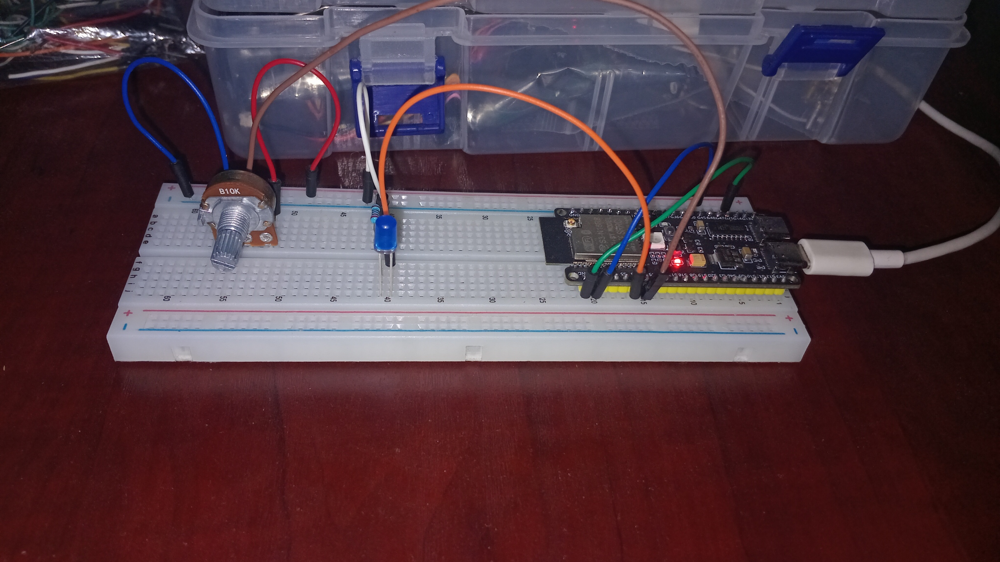
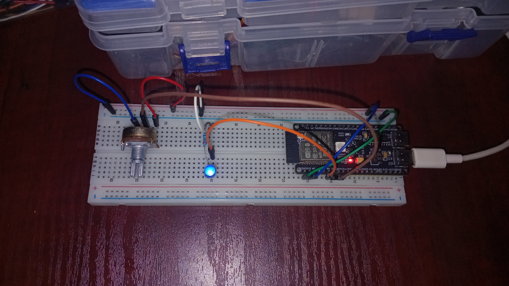
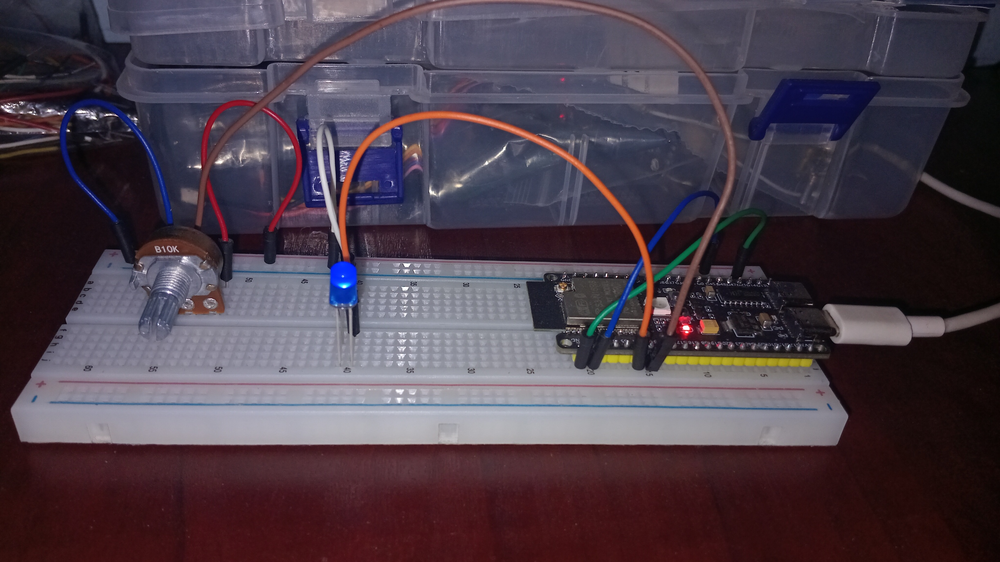

# Analog Sensor to LED Brightness

Read an analog sensor and use its value to control LED brightness with PWM. The repository contains separate sketches for an ESP32-S3 N16R8 development board and an Arduino Uno R3.

## Folder structure

```text
analog-sensor-led/
├── README.md
└── src/
    ├── esp32_s3_n16r8/
    │   └── esp32_s3_n16r8.ino
    └── arduino_uno_r3/
        └── arduino_uno_r3.ino
```

## Hardware

- ESP32-S3 N16R8 development board, or Arduino Uno R3
- Analog sensor connected to the board's listed analog input
- LED with a suitable current-limiting resistor connected to the listed PWM output
- Common ground between the sensor and board

Check your board's pinout and the sensor's voltage range before connecting it. Do not apply more than 3.3 V to an ESP32-S3 input.

## Images

Add your project photos to an `images/` folder in the repository, then replace these filenames with the actual image names:

### ESP32-S3 N16R8 setup





## Pin and range settings

| Board | Analog input | PWM output | Serial baud | Sensor range used |
| --- | --- | --- | --- | --- |
| ESP32-S3 N16R8 | GPIO 7 | GPIO 6 | 115200 | 0–4095 |
| Arduino Uno R3 | A1 | D6 | 9600 | 0–466 (calibrate for your sensor) |

Both sketches map the sensor range to PWM values from 0 to 255 and print the raw reading and mapped output every 100 ms. The Uno's `466` upper sensor value is an example calibration value; change it to match the actual maximum reading from your sensor. The Uno ADC can read up to 1023.

## Upload

1. Open the sketch for your board in the Arduino IDE.
2. Select the matching board and port.
3. Upload the sketch.
4. Open Serial Monitor at the baud rate in the table above.

The ESP32-S3 sketch uses `analogWrite()`, supported by current Arduino-ESP32 cores. If your installed core does not provide it, update the ESP32 board package or adapt the sketch to that core's LEDC PWM API.

## GitHub repository name

`analog-sensor-led-brightness`
